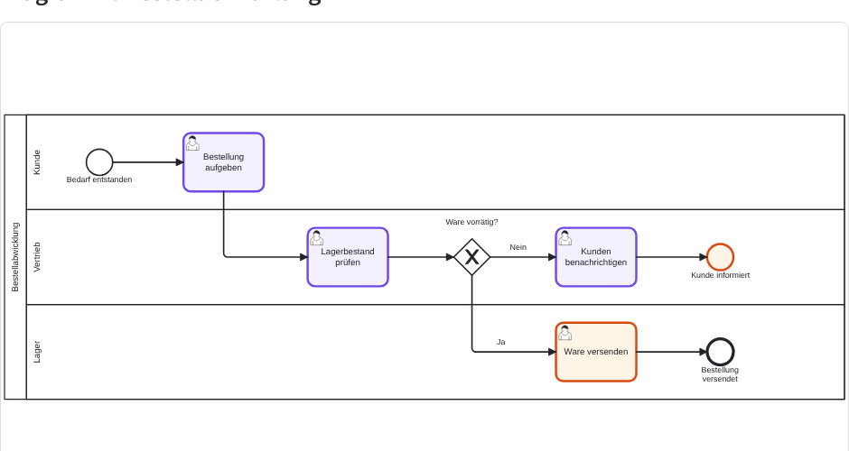
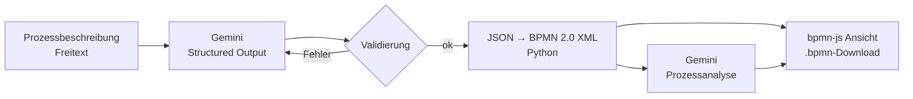

# Prozess Copilot

**Von der Prozessbeschreibung in natürlicher Sprache zum validen BPMN-2.0-Diagramm – inklusive Schwachstellenanalyse und Automatisierungsvorschlägen.**

Fachabteilungen beschreiben Abläufe meist in Fließtext. Prozess Copilot übersetzt solche Beschreibungen mithilfe eines Large Language Models (Google Gemini) in ein strukturiertes Prozessmodell, prüft es automatisch, erzeugt daraus standardkonformes BPMN 2.0 und schlägt konkrete Verbesserungen vor.



*Eingabe:* „Der Kunde gibt eine Bestellung auf. Der Vertrieb prüft den Lagerbestand. Ist die Ware vorrätig, versendet das Lager sie, andernfalls wird der Kunde benachrichtigt.“
*Farbig markiert:* Schwachstellen (orange), Automatisierungspotenziale (grün), beides (violett).

---

## Funktionsweise



| # | Schritt | Umsetzung | Code |
|---|---------|-----------|------|
| 1 | **Eingabe** – Prozess in eigenen Worten beschreiben | Streamlit | `app.py` |
| 2 | **Text → JSON** – Rollen (Lanes), Aufgaben, Gateways und Sequenzflüsse extrahieren | Gemini mit JSON-Schema (Structured Output), Schema als Pydantic-Modell | `copilot/llm.py`, `copilot/schema.py` |
| 3 | **Validierung & Reparaturschleife** – Start/Ende vorhanden? Unverbundene Aufgaben? Erreicht jeder Pfad ein Ende? Bedingungen an XOR-Gateways? Bei Fehlern erhält das Modell die Fehlerliste und korrigiert (Standard: bis zu 3 Versuche) | Python (Graphanalyse) | `copilot/validate.py` |
| 4 | **JSON → BPMN 2.0 XML** inkl. automatischem Layout (BPMNDI) | Deterministischer Python-Code, **kein LLM** | `copilot/bpmn.py` |
| 5 | **Darstellung & Export** – interaktives Diagramm, Download als `.bpmn` (Camunda, Signavio, bpmn.io) und JSON | bpmn-js | `copilot/viewer.py` |
| 6 | **Analyse** – Engpässe, unnötige Übergaben, Wartezeiten sowie Automatisierungspotenziale (RPA / API / KI) | Zweiter Gemini-Aufruf, ebenfalls schema-gebunden | `analyze_process()` |

## Designentscheidungen

- **Das LLM erzeugt nur Struktur, nie XML.** BPMN-XML ist umfangreich und fehleranfällig. Das Modell liefert ein schlankes, schema-gebundenes JSON; die Übersetzung in BPMN übernimmt deterministischer Code. Das Ergebnis ist dadurch immer syntaktisch gültig und reproduzierbar.
- **Zuverlässige Übergabe durch Structured Output und Validierung.** Das Pydantic-Schema wird als JSON-Schema an Gemini übergeben und die Antwort mit demselben Schema geprüft. Zusätzlich prüft eine Graphanalyse die *fachliche* Korrektheit des Prozesses. Die Fehlermeldungen sind so formuliert, dass das Modell sie direkt zur Selbstkorrektur nutzen kann.
- **Schutz vor Halluzinationen in der Analyse.** Verweise des Modells auf nicht existierende Elemente werden automatisch entfernt.
- **Automatisches Layout.** Spalten ergeben sich aus dem längsten Pfad im Prozessgraphen, Schleifen werden per Tiefensuche erkannt und unten herum geführt, Zeilen werden je Lane verteilt.
- **Testbar ohne API.** Ein Demo-Client simuliert Gemini – inklusive einer fehlerhaften ersten Antwort, um die Reparaturschleife vorzuführen. Die Tests laufen dadurch offline und deterministisch.

## Schnellstart

```bash
git clone https://github.com/Dona7s/prozess-copilot.git
cd prozess-copilot
pip install -r requirements.txt

export GEMINI_API_KEY="..."              # https://aistudio.google.com/apikey
export GEMINI_MODEL="gemini-3.8-flash"   # optional, jedes aktuelle Gemini-Modell möglich

streamlit run app.py
```

Ohne API-Schlüssel startet die Anwendung im **Demo-Modus** mit dem Beispielprozess.

## Tests

```bash
python -m pytest -q
```

Abgedeckt sind u. a. die Reparaturschleife, Schema- und Graphfehler, die BPMN-XML-Struktur, Schleifen und ungültige IDs sowie das Entfernen halluzinierter Verweise. Die Tests laufen bei jedem Push über GitHub Actions.

## Projektstruktur

```
prozess-copilot/
├── app.py                  # Streamlit-Oberfläche
├── copilot/
│   ├── schema.py           # Pydantic-Modelle (Prozess + Analyse)
│   ├── llm.py              # Gemini-Client, Prompts, Reparaturschleife, Analyse
│   ├── validate.py         # Graphbasierte Prüfung des Prozessmodells
│   ├── bpmn.py             # JSON → BPMN 2.0 XML inkl. Layout
│   ├── viewer.py           # bpmn-js-Einbettung
│   └── demo.py             # Offline-Demo-Client und Beispieldaten
├── examples/
│   └── bestellabwicklung.bpmn
└── tests/
    └── test_pipeline.py
```

## Technologien

Python · Google Gemini API (`google-genai`) · Pydantic · Streamlit · bpmn-js · BPMN 2.0 · pytest · GitHub Actions

## Ausblick

- Weitere BPMN-Elemente (Zwischenereignisse, Nachrichtenflüsse, Subprozesse)
- Diagramm iterativ per Chat bearbeiten („Füge eine Freigabe durch die Buchhaltung hinzu“)
- Import bestehender `.bpmn`-Dateien zur Analyse
- Evaluation der Extraktionsqualität über einen Testkorpus von Prozessbeschreibungen
