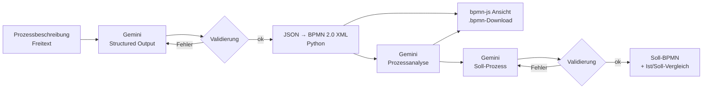
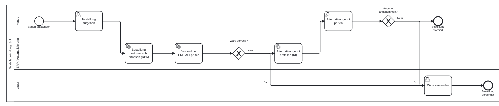

# Prozess Copilot

**Von der Prozessbeschreibung in natürlicher Sprache zum validen BPMN-2.0-Diagramm – inklusive Schwachstellenanalyse, Automatisierungsvorschlägen und verbessertem Soll-Prozess.**

Fachabteilungen beschreiben Abläufe meist in Fließtext. Prozess Copilot übersetzt solche Beschreibungen mithilfe eines Large Language Models (Google Gemini) in ein strukturiertes Prozessmodell, prüft es automatisch, erzeugt daraus standardkonformes BPMN 2.0, analysiert Schwachstellen und entwirft einen verbesserten Soll-Prozess (To-Be) – ebenfalls als BPMN.


*Eingabe:* „Der Mitarbeiter stellt einen Urlaubsantrag im Portal. Der Teamleiter prüft den Antrag. Wenn er genehmigt wird, trägt die Personalabteilung den Urlaub ins System ein und der Mitarbeiter erhält eine Bestätigung. Wenn er abgelehnt wird, bekommt der Mitarbeiter eine Begründung per E-Mail.“

In der Anwendung werden nach der Analyse zusätzlich Schwachstellen (orange), Automatisierungspotenziale (grün) und beides (violett) farbig markiert.

---

## Funktionsweise



| # | Schritt | Umsetzung | Code |
|---|---------|-----------|------|
| 1 | **Eingabe** – Prozess in eigenen Worten beschreiben oder als PDF-, Word- bzw. Textdatei hochladen (inkl. Tabellen in Word) | Streamlit, pypdf, python-docx | `app.py`, `copilot/documents.py` |
| 2 | **Text → JSON** – Rollen (Lanes), Aufgaben, Gateways und Sequenzflüsse extrahieren | Gemini mit JSON-Schema (Structured Output), Schema als Pydantic-Modell | `copilot/llm.py`, `copilot/schema.py` |
| 3 | **Validierung & Reparaturschleife** – Start/Ende vorhanden? Unverbundene Aufgaben? Erreicht jeder Pfad ein Ende? Bedingungen an XOR-Gateways? Bei Fehlern erhält das Modell die Fehlerliste und korrigiert (Standard: bis zu 3 Versuche) | Python (Graphanalyse) | `copilot/validate.py` |
| 4 | **JSON → BPMN 2.0 XML** inkl. automatischem Layout (BPMNDI) | Deterministischer Python-Code, **kein LLM** | `copilot/bpmn.py` |
| 5 | **Darstellung & Export** – interaktives Diagramm mit Zoom, „Einpassen“ und Vollbild; Download als `.bpmn` (Camunda, Signavio, bpmn.io) und JSON | bpmn-js | `copilot/viewer.py` |
| 6 | **Analyse** – Engpässe, unnötige Übergaben, Wartezeiten sowie Automatisierungspotenziale (RPA / API / KI) | Zweiter Gemini-Aufruf, ebenfalls schema-gebunden | `analyze_process()` |
| 6a | **Bearbeitung per Chat** – Diagramm mit Anweisungen in natürlicher Sprache ändern („Füge eine Freigabe durch die Buchhaltung hinzu“), inkl. Verlauf, Änderungsübersicht und Rückgängig | Gemini liefert das vollständige geänderte Modell, das dieselbe Validierung und Reparaturschleife durchläuft; Unterschiede berechnet Python | `edit_process()` |
| 7 | **Soll-Prozess (To-Be)** – verbesserter Prozess auf Basis der Analyse, mit Änderungsübersicht; Ist und Soll in Tabs bzw. nebeneinander, neue Elemente hervorgehoben | Dritter Gemini-Aufruf mit derselben Validierung und Reparaturschleife; Kennzahlenvergleich in Python | `propose_to_be()`, `copilot/compare.py` |
| 8 | **PDF-Bericht** – Ist-Diagramm, Analyse, Soll-Prozess, Änderungen und Kennzahlen in einem Dokument ([Beispiel](docs/beispielbericht.pdf)) | reportlab; Diagramme als Vektorgrafik direkt aus dem Layout gezeichnet, sehr breite Prozesse werden in lesbare Abschnitte geteilt | `copilot/report.py` |

## Designentscheidungen

- **Das LLM erzeugt nur Struktur, nie XML.** BPMN-XML ist umfangreich und fehleranfällig. Das Modell liefert ein schlankes, schema-gebundenes JSON; die Übersetzung in BPMN übernimmt deterministischer Code. Das Ergebnis ist dadurch immer syntaktisch gültig und reproduzierbar.
- **Zuverlässige Übergabe durch Structured Output und Validierung.** Das Pydantic-Schema wird als JSON-Schema an Gemini übergeben und die Antwort mit demselben Schema geprüft. Zusätzlich prüft eine Graphanalyse die *fachliche* Korrektheit des Prozesses. Die Fehlermeldungen sind so formuliert, dass das Modell sie direkt zur Selbstkorrektur nutzen kann.
- **Bearbeiten durch Neugenerierung statt fragiler Patches.** Für Chat-Änderungen gibt das Modell das komplette geänderte JSON zurück (mit der Vorgabe, IDs unveränderter Elemente beizubehalten). Das ist robuster als JSON-Patches mit Pfadangaben, und das Ergebnis lässt sich vollständig validieren. Welche Elemente tatsächlich neu sind oder entfallen, zeigt ein deterministischer Vergleich.
- **Ein Validierungspfad für Ist und Soll.** Der Soll-Prozess nutzt dasselbe Schema, dieselbe Graphprüfung und dieselbe Reparaturschleife wie die Extraktion. Ein „verbesserter“ Prozess mit Sackgassen kann so nicht entstehen.
- **Fakten statt LLM-Behauptungen beim Vergleich.** Die Änderungsübersicht formuliert das Modell, die Kennzahlen (manuelle vs. automatisierte Aufgaben, manuelle Übergaben zwischen Rollen, neue und entfallene Elemente) berechnet dagegen deterministischer Code aus beiden Modellen.
- **Schutz vor Halluzinationen in der Analyse.** Verweise des Modells auf nicht existierende Elemente werden automatisch entfernt.
- **Automatisches Layout und Routing.** Spalten ergeben sich aus dem längsten Pfad im Prozessgraphen, Schleifen werden per Tiefensuche erkannt und unten herum geführt. Zweige behalten die Zeile ihres Vorgängers. Sequenzflüsse werden orthogonal in den freien Kanälen zwischen den Spalten geführt: Für jeden Fluss werden mehrere Routen erzeugt und so bewertet, dass keine Linie durch ein Element läuft und keine zwei Flüsse deckungsgleich übereinanderliegen. Ein Test prüft das für mehrere Beispielprozesse.
- **Ein Layout, zwei Ausgaben.** Die Diagrammgeometrie wird einmal berechnet und sowohl für BPMNDI (Camunda, Signavio, bpmn-js) als auch für den PDF-Bericht verwendet. Der Bericht braucht deshalb keinen Browser und keine Screenshots.
- **Testbar ohne API.** Ein Demo-Client simuliert Gemini – inklusive einer fehlerhaften ersten Antwort, um die Reparaturschleife vorzuführen. Die Tests laufen dadurch offline und deterministisch.

## Schnellstart

```bash
git clone https://github.com/Dona7s/prozess-copilot.git
cd prozess-copilot
pip install -r requirements.txt

export GEMINI_API_KEY="..."              # https://aistudio.google.com/apikey
export GEMINI_MODEL="gemini-3.8-flash"   # optional, jedes aktuelle Gemini-Modell möglich

streamlit run app.py
```

Ohne API-Schlüssel startet die Anwendung im **Demo-Modus** mit dem Beispielprozess (inklusive Analyse und Soll-Prozess).

### Beispiel: Soll-Prozess

Aus der Bestellabwicklung entwirft der Copilot u. a. eine automatische Bestandsprüfung per ERP-API und ein KI-gestütztes Alternativangebot, wenn Ware fehlt:



## Evaluation: Wie zuverlässig ist die Übergabe Text → Struktur?

Ein Testkorpus mit **12 deutschsprachigen Prozessbeschreibungen** aus verschiedenen Bereichen (Vertrieb, Personal, Finanzen, Bank, IT, Logistik, Gesundheit) liegt in [`eval/dataset.json`](eval/dataset.json). Zu jedem Fall ist die erwartete Struktur hinterlegt: Rollen, Aktivitäten, Anzahl der Entscheidungen (XOR) und paralleler Verzweigungen (AND). Darunter sind Fälle mit mehreren Entscheidungen, mit Schleifen (Nachforderung, erneute Bearbeitung) und mit Parallelität.

Gemessen wird:

| Kennzahl | Bedeutung |
|---|---|
| **First-Try-Validität** | Anteil der Antworten, die ohne Korrektur schema- *und* graphvalide sind |
| **Validität nach Reparatur** | Anteil gültiger Modelle nach der Reparaturschleife |
| **Ø Generierungen** | Wie viele LLM-Aufrufe im Schnitt nötig waren |
| **Rollen (F1), Aktivitäten (Recall)** | Strukturelle Übereinstimmung mit der Erwartung, Namensabgleich über Wortstämme (z. B. „Bestand im Lager prüfen“ ≙ „Lagerbestand prüfen“) |
| **Entscheidungen / Parallelität korrekt** | Stimmt die Anzahl der XOR- bzw. AND-Verzweigungen? |
| **Fehlerarten** | Welche Validierungsfehler im ersten Versuch auftreten (Erreichbarkeit, fehlende Bedingungen, …) |

```bash
export GEMINI_API_KEY="..."
python eval/run_eval.py --runs 3 --update-readme   # 3 Läufe je Fall, um die Streuung zu sehen
```

Rohdaten und Berichte landen in `eval/results/`, die Tabelle unten wird mit `--update-readme` automatisch ersetzt.

### Ergebnisse

<!-- EVAL:START -->
*Noch nicht ausgeführt.* Ergebnisse erscheinen hier nach `python eval/run_eval.py --update-readme`.
<!-- EVAL:END -->

### Ablation: Was bringen Structured Output und Reparaturschleife?

Um den Beitrag der beiden Mechanismen zu isolieren, wird derselbe Korpus in vier Varianten ausgewertet:

| Variante | Schema-Vorgabe | Reparaturschleife |
|---|---|---|
| Structured Output + Reparatur (Standard) | `response_json_schema` (vom Modell beim Dekodieren eingehalten) | ja |
| Structured Output, ohne Reparatur | `response_json_schema` | nein |
| Nur Prompt + Reparatur | JSON-Schema nur als Text im System-Prompt, freie Antwort | ja |
| Nur Prompt, ohne Reparatur | JSON-Schema nur als Text im System-Prompt, freie Antwort | nein |

Bei reinem Prompting werden Code-Fences und Begleittext tolerant entfernt (`extract_json_text`), damit die Baseline nicht an Formalitäten scheitert. Die Varianten ohne Reparatur entsprechen dem ersten Versuch der Läufe mit Reparatur (identischer Aufruf). Das halbiert die API-Kosten, ohne das Ergebnis zu verändern.

```bash
python eval/run_eval.py --ablation --runs 3 --update-readme
```

<!-- ABLATION:START -->
*Noch nicht ausgeführt.* Ergebnisse erscheinen hier nach `python eval/run_eval.py --ablation --update-readme`.
<!-- ABLATION:END -->

## Tests

```bash
python -m pytest -q
```

Abgedeckt sind u. a. die Reparaturschleife (auch für den Soll-Prozess), der Ist/Soll-Vergleich, Schema- und Graphfehler, die BPMN-XML-Struktur, Schleifen und ungültige IDs sowie das Entfernen halluzinierter Verweise. Die Tests laufen bei jedem Push über GitHub Actions.

## Projektstruktur

```
prozess-copilot/
├── app.py                  # Streamlit-Oberfläche
├── copilot/
│   ├── schema.py           # Pydantic-Modelle (Prozess + Analyse)
│   ├── llm.py              # Gemini-Client, Prompts, Reparaturschleife, Analyse, Soll-Prozess
│   ├── validate.py         # Graphbasierte Prüfung des Prozessmodells
│   ├── bpmn.py             # JSON → BPMN 2.0 XML inkl. Layout und Routing
│   ├── compare.py          # Ist/Soll-Vergleich und Kennzahlen
│   ├── evaluation.py       # Bewertung: Validität, Reparaturen, Strukturgenauigkeit
│   ├── viewer.py           # bpmn-js-Einbettung mit Zoom und Vollbild
│   ├── demo.py             # Offline-Demo-Client und Beispieldaten
│   ├── documents.py        # Textextraktion aus PDF, Word und Text
│   └── report.py           # PDF-Bericht mit Vektordiagrammen
├── eval/
│   ├── dataset.json        # Testkorpus mit erwarteter Struktur
│   ├── run_eval.py         # Evaluationsskript (CLI)
│   └── results/            # Ergebnisse der Läufe
├── examples/
│   ├── bestellabwicklung.bpmn
│   ├── rechnungspruefung.pdf   # Beispiel für den Datei-Upload
│   └── onboarding.docx         # Beispiel für den Datei-Upload
└── tests/
    └── test_pipeline.py
```

## Technologien

Python · Google Gemini API (`google-genai`) · Pydantic · Streamlit · bpmn-js · pypdf · python-docx · reportlab · BPMN 2.0 · pytest · GitHub Actions

## Ausblick

- Weitere BPMN-Elemente (Zwischenereignisse, Nachrichtenflüsse, Subprozesse)
- Import bestehender `.bpmn`-Dateien zur Analyse
- Vergleich mehrerer Modelle (z. B. Flash vs. Pro) in der Evaluation
